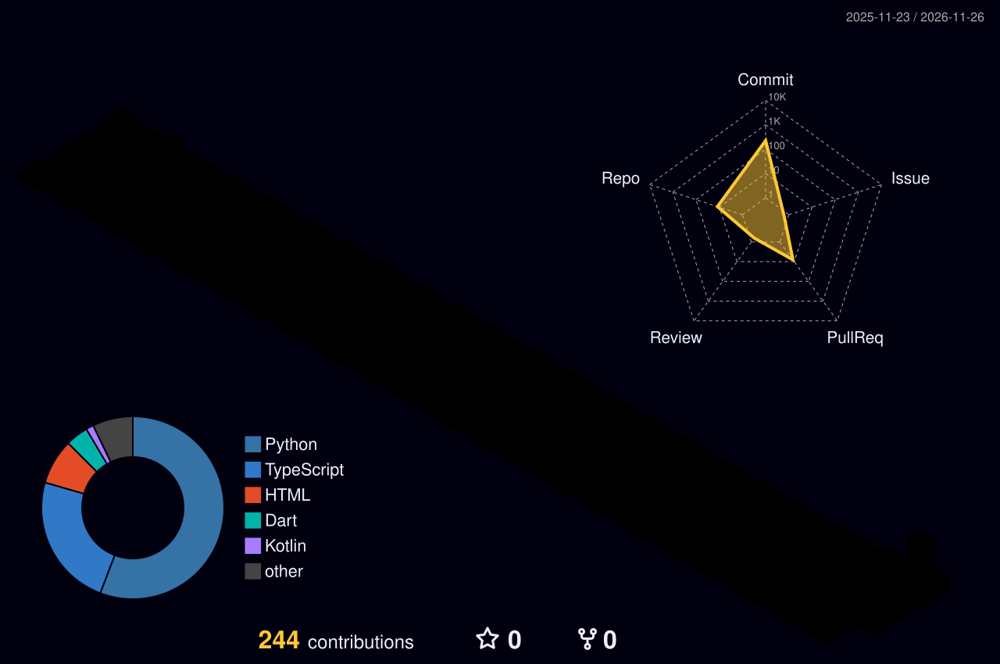

## Hola, soy Samuel 👋

Ingeniero en Sistemas Computacionales. Construyo software que tiene que funcionar en el mundo real: asistentes con IA que citan sus fuentes, juegos con mundos procedurales, bots para comunidades y flotas de transporte en un mapa en vivo. También diseño las interfaces, logos y videos de mis proyectos con la suite **ArtCraft**.

- 🧠 **Ahora mismo:** Copiloto de Minecraft, RAG con NVIDIA Nemotron y pgvector.
- 🎮 **En paralelo:** PROCEDIMENTAL, un juego de fábricas, robots y oleadas en Roblox.
- 📡 **Aprendiendo:** CCNA, pfSense y patrones de arquitectura.

## 🚀 Proyectos destacados

<table>
<tr>
<td width="50%" valign="top">

<h3>🤖 Copiloto de Minecraft</h3>

**Un asistente con IA que vive dentro del juego.** Respondes una pregunta en Minecraft Java y te contesta en español, citando de dónde sale cada dato.

- 📚 ~4.200 fichas del juego indexadas con embeddings de NVIDIA
- 🧮 Calcula daño, recetas y encantamientos con código, no de memoria
- 🎒 Lee tu inventario, vida y posición en vivo
- 🏰 Construye casas, castillos y aldeas que siguen el relieve, amuebladas por dentro
- ↩️ Vista previa, confirmación y «deshacer» para todo lo que cambia el mundo

🔒 Repositorio privado

</td>
<td width="50%" valign="top">

<h3>🏭 PROCEDIMENTAL</h3>

**Juego de fábricas y defensa por oleadas en Roblox.** Extraes minerales, montas tu cadena de producción y defiendes el núcleo con un ejército de robots.

- 🌋 Mundo procedural con lagos y vetas de 10 minerales
- ⛏️ Extractores por rareza, red solar, energía y líquidos compartidos
- 🦾 25 especies de robots en familias (Bastión, Céfiro, Crawler, cuadrúpedos…)
- 🎮 Robots pilotables en primera persona con armas por familia
- ✨ Efectos visuales, modelos e interfaces propios

🛠️ En desarrollo

</td>
</tr>
<tr>
<td width="50%" valign="top">

<h3>🎯 <a href="https://github.com/SMZNOSK/vex-latam-system">VEX LATAM SYSTEM</a></h3>

**El bot que organiza una comunidad gamer en Discord.** Perfiles, búsqueda de equipo y administración en un solo lugar.

- 🔎 Búsquedas de equipo publicadas en varios canales a la vez, sin duplicados
- 🛡️ Clanes, torneos, roles, reglas y moderación configurable
- 📣 Promociones de creadores con carátula y vista previa
- 🗂️ Panel administrativo, buzones de feedback y reportes
- 🚀 Arranque con comprobaciones automáticas y guía publicada desde HTML

🟢 En producción

</td>
<td width="50%" valign="top">

<h3>🚐 Sistema de Transporte</h3>

**Rastreo de flota en tiempo real para un complejo hotelero.** Cuatro aplicaciones conectadas a la misma plataforma.

- 🗺️ Mapa en vivo con telemetría de cada unidad
- 📍 Geocercas y rutas con PostGIS
- 🖥️ 2 paneles web para operación y administración
- 📱 App para colaboradores (Flutter) y app para transportistas (Kotlin)
- 🐳 Despliegue con Docker

🔒 Proyecto de cliente

</td>
</tr>
</table>

<b>Otros proyectos</b>

 

- 🧾 [**Punto de Venta Offline**](https://github.com/SMZNOSK/punto_venta_offline) · Flutter, Drift y SQLite. POS sin internet con inventario, caja, PIN e impresión en ticketera térmica.
- 🖥️ [**Inventario TI**](https://github.com/SMZNOSK/ITInventario) · Next.js y TypeScript. Control de equipos y activos de TI.
- 🍕 **Plataforma de pedidos** · Laravel, MySQL, Twilio y WhatsApp API, con avisos automáticos.

## 🛠️ Con qué trabajo

    
    
    
  

<h3 align="center">🎨 Diseño y contenido con ArtCraft</h3>

  
  
  
  

Interfaces de PC y móvil, logos, intros y clips para mis proyectos y comunidades.

## 💼 Experiencia

**Desarrollador Full-Stack y Operaciones Digitales**

- 📊 Monitoreo en tiempo real de flotas vehiculares con mapas y telemetría.
- 📱 App POS offline con Flutter y ticketera térmica.
- ✅ **70 %** más precisión en entregas del sistema de empaque.
- 🔄 Reestructuración de inventarios digitales y digitalización de procesos en el sector alimenticio.
- ☁️ Despliegue y operación en AWS (EC2, S3, RDS).

## 📈 Actividad

<picture>
  <source media="(prefers-color-scheme: dark)" srcset="./profile-3d-contrib/profile-night-rainbow.svg" />
  <source media="(prefers-color-scheme: light)" srcset="./profile-3d-contrib/profile-season.svg" />
  
</picture>

<picture>
  <source media="(prefers-color-scheme: dark)" srcset="https://raw.githubusercontent.com/SMZNOSK/smznosk/output/github-contribution-grid-snake-dark.svg" />
  <source media="(prefers-color-scheme: light)" srcset="https://raw.githubusercontent.com/SMZNOSK/smznosk/output/github-contribution-grid-snake.svg" />
  
</picture>

